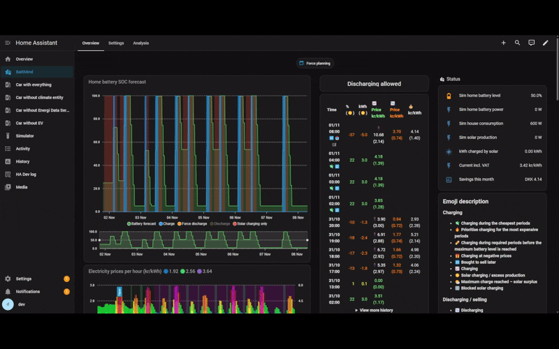
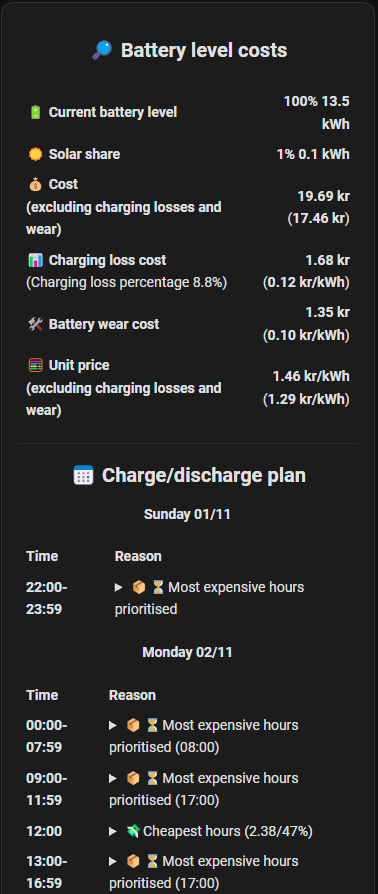
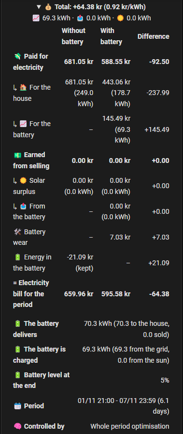
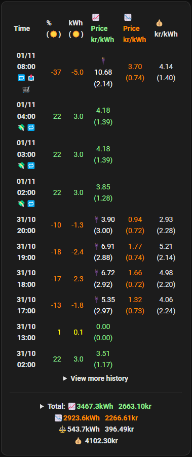

# BattMind🤵‍♂️🔋⚡ for Home Assistant

**Home battery optimisation that aims to save and earn as much money as possible from the battery.**

  

- 💰 **Knows what every stored kWh cost** – grid or solar, charging and discharging loss and battery wear
- 📈 **Sells only when it pays** – after loss, wear and your own profit requirements (energy past its max. age is the exception)
- 🧠 **Plans 1–7 days ahead** – whole-period optimisation, or individually selectable rules that explain every decision
- 🔍 **Shows what the battery really earned** – savings, forecast accuracy and a hindsight score per day
- 🔌 **Fits any controllable inverter** – the blueprint lets you map each action to your own inverter integration, so you set up the control yourself, with [ready-made actions](docs/README.md#inverters) for some
- 🧪 **What-if simulator** – replay the planner on your own history with another battery or other settings

**How it works:** prices, solar forecast and consumption → BattMind's plan → `sensor.battmind_powerwall_action` → the
included blueprint → your inverter. BattMind exposes what the battery should do; your automation applies it to the inverter.
The included blueprint does that once you have added your inverter's commands for each action.

> [!NOTE]
> This is the **integration version** of BattMind. It replaces the
> [PyScript version](https://github.com/dezito/BattMind) and can import its configuration and
> databases. See [Switching from the PyScript version](docs/migration.md).

🌐 <a href="https://dezito.github.io/BattMind-Integration/" target="_blank" rel="noopener"><strong>Documentation website</strong></a> – the documentation as a website with a menu.

📖 **[Documentation](docs/README.md)** – [tested integrations by country](docs/tested-integrations.md), [getting started](docs/getting-started.md), [how BattMind plans](docs/how-it-works.md),
every rule explained with examples, [inverter setups](docs/README.md#inverters), [how BattMind compares with other
optimisers](docs/comparison.md) and [FAQ](docs/faq-troubleshooting.md).

---

## Features

The full list is in [Features](docs/features.md).

- **Charging plan for 1–7 days** from electricity prices, forecasts and your own consumption history
- **Two ways to control the battery:** [whole period optimisation](docs/rules/optimizer.md) (default) or rules that decide each hour
- **[Charging rules](docs/rules/charging.md):** cheapest periods, fill up, most expensive periods, required before max level, negative prices, buy to sell and a periodic full charge
- **[Discharging rules](docs/rules/discharging.md):** profit only, prioritise by energy cost, before the sun and max. age of kWh
- **[Selling rules](docs/rules/selling.md):** maximise profit, sell excess kWh, minimum profit and excluded hours
- **[Storm warning](docs/rules/storm.md) (optional):** keeps the battery charged for a MeteoAlarm storm warning
- **[Solar](docs/rules/solar.md) (optional):** surplus charging, optimised solar charging and a forecast from Solcast, Forecast.Solar or Helios Forecast and/or own history
- **[Cost price of the battery's energy](docs/how-it-works.md#the-cost-of-a-kwh-from-the-battery)** including source, loss and wear
- **Price providers:** [Energi Data Service](https://github.com/MTrab/energidataservice), [Strømligning](https://github.com/MTrab/stromligning), [Energy Price Forecast](https://github.com/BackupBaTTerY/energypriceforecast-home-assistant), the spot forecast integrations (Spot Forecast, Elprisprognos, Wattcast) and your own published prices (EPEX Spot, GE-Spot, Octopus Energy, Nord Pool), with a [price database](docs/how-it-works.md#prices) as fail-safe
- **[Analysis](docs/dashboard-analysis.md#analysis)** and a **[what-if simulator](docs/what-if-simulator.md)**
- **[Ready-made dashboard](docs/dashboard-analysis.md)**, several instances, five languages (Danish, English, German, Polish and Ukrainian)

| Battery level costs and plan | Bill with and without battery | Charging history |
| --- | --- | --- |
|  |  |  |

---

## How to control the home battery

BattMind sends **no commands** to your inverter. It exposes what the battery should do right now:

| `sensor.battmind_powerwall_action` | Meaning |
|---|---|
| `battery_stopped` | Stop charging and discharging because the configured battery temperature is unsafe or unavailable |
| `grid_charging` | Charge the battery from the grid now |
| `discharge_allowed` | Normal operation: the battery isn't really controlled – it charges from solar and discharges to the house as the inverter normally does |
| `force_discharge` | Discharge / sell to the grid now (the most expensive hours) |
| `force_solar_only_charging` | Charge from solar only, no discharging |
| `blocked_solar_charge` | Don't charge from solar (the surplus is sold instead) |

The easiest way is the **blueprint** that is installed with the integration
(*Settings → Automations & scenes → Blueprints → BattMind - control the home battery*). It works with all
inverters: you add what your inverter should do for each action, and optionally what should happen while
an EV is charging. See [Actions and battery control](docs/actions.md) and the
[inverter pages](docs/README.md#inverters): [Huawei Solar](docs/inverters/huawei.md),
[SolarEdge](docs/inverters/solaredge.md), [Deye](docs/inverters/deye-solarman.md) and
[Sofar](docs/inverters/sofar-solarman.md) (the last three are checked against the source, not tested).

Find a ready-made setup for your inverter, or share your own, under
[Blueprint setups](https://github.com/dezito/BattMind-Integration/discussions/categories/blueprint-setups).

The blueprint file is never overwritten on its own. If a new version arrives with a HACS update (or you
have edited the file yourself), a repair shows up after restart under *Settings → System → Repairs*. If
you choose to update, the file is replaced with the bundled version, and automations using it are
reloaded. If the file is deleted, the latest version is put back on the next restart.

`sensor.battmind_current_charging_rule` shows why (e.g. *Charging up to 💸*), and
`sensor.battmind_battery_level_needed` shows how much battery is needed until the next charge.
The main entities and services are listed in [Entities and services](docs/reference.md).

---

## Requirements

- Home Assistant **2025.12** or newer with recorder (default)
- A sensor for the home battery's **battery level** (%) and **power** (W)
- A sensor for the **house consumption** (W)
- Price integration: [Energi Data Service](https://github.com/MTrab/energidataservice), [Strømligning](https://github.com/MTrab/stromligning), [Energy Price Forecast](https://github.com/BackupBaTTerY/energypriceforecast-home-assistant) and/or a spot forecast integration, EPEX Spot, GE-Spot, Octopus Energy or Nord Pool (HACS)
- Optional:
  - battery temperature sensor for a configurable charge/discharge safety stop
  - solar production (W)
  - a solar forecast: [Solcast PV Forecast](https://github.com/BJReplay/ha-solcast-solar),
    [Forecast.Solar](https://www.home-assistant.io/integrations/forecast_solar/) or
    [Helios Forecast](https://github.com/ReikanYsora/Helios-Forecast)
  - a weather integration that supports `weather.get_forecasts` with cloud cover, e.g.
    [Meteorologisk institutt](https://www.home-assistant.io/integrations/met/),
    [AccuWeather](https://www.home-assistant.io/integrations/accuweather/) or
    [OpenWeather](https://www.home-assistant.io/integrations/openweathermap/)
- For the dashboard (install these HACS frontend cards): [ApexCharts Card](https://github.com/RomRider/apexcharts-card),
  [Mushroom](https://github.com/piitaya/lovelace-mushroom),
  [Config Template Card](https://github.com/iantrich/config-template-card),
  [Timer Bar Card](https://github.com/rianadon/timer-bar-card) and
  [card-mod](https://github.com/thomasloven/lovelace-card-mod) (only styling). If Home Assistant can't find
  some of them, a persistent notification lists them with links

---

## Installation

### HACS (recommended)

1. Open **HACS**, search for **BattMind**, install it, and restart Home Assistant.
2. Add the integration:

   

   or **Settings → Devices & services → Add integration → BattMind**.
3. Create the automation that controls the home battery, e.g. with the [blueprint](docs/actions.md#the-blueprint).

If **BattMind** does not show up in the HACS search, add it as a custom repository first: **HACS** → ⋮ →
**Custom repositories** → `https://github.com/dezito/BattMind-Integration` with type **Integration**, then search again.

### Manual

Download `battmind.zip` from the [latest release](https://github.com/dezito/BattMind-Integration/releases/latest),
unpack it into `config/custom_components/battmind` and restart Home Assistant.

---

## Setup

Setup is done in the UI, split into small pages with help texts: prefix and language, the home battery
(sensors, size, levels, power, loss, wear and controllable modes), consumption, price providers, solar panels
and weather, advanced settings (days to plan, interval, dashboard, diagnostic file log) and the database.
Everything can be changed afterwards under **Configure** on the integration, and it reloads when you save.
[Getting started](docs/getting-started.md) goes through every page and how to set the values.

---

## Dashboard

With **Dashboard in the sidebar** enabled (default), each instance gets its own dashboard,
e.g. `/battmind-dashboard`, with four views:

- **Overview:** battery level forecast, prices, current rule and action, status, charging history and the plan
- **Settings:** the planners and their limits, grouped, each with a "Read more"
- **Analysis:** what the battery earns and how well BattMind plans
- **What-if:** run the what-if simulator and view the last saved calculation

Every card is explained in [Dashboard and analysis](docs/dashboard-analysis.md). Once you save your own
changes to the dashboard, your version is kept. Press **Reset dashboard** (on the integration's device) to
go back to the generated dashboard.

---

## Backup: export and import of data

A backup is one JSON file in `/config/battmind_backups/` with the databases, the settings (switches, numbers, ...) and the configuration from the setup. The folder is included in Home Assistant's own backups.

- **When you delete an instance**, a backup is saved automatically (`…_deleted.json`) before the databases are removed.
- **Export** with the *Export data* button on the device, under **Configure → Backup** or with `battmind.export_data`.
- **Import into a new instance**: when you create a new one, the setup offers to restore one of the backups. The configuration is pre-filled, and databases and settings are restored on first start.
- **Import into an existing instance** under **Configure → Backup** or with `battmind.import_data` (`file: battmind_20261024_120000.json`). Databases and settings are replaced, and the integration is reloaded. The current data is first saved as `…_before_import.json`, so an import can be undone. With `restore_configuration` the configuration is also taken over. Leave it off when the backup comes from another Home Assistant.

---

## Switching from the PyScript version

If `battmind_config.yaml` exists in the config folder, the setup offers to import its configuration and
databases, and the values of the old helpers are copied to the new entities. The PyScript files are only
read, never changed, so both versions can run side by side with different prefixes.
See [Switching from the PyScript version](docs/migration.md) for the steps and what became what.

---

## Troubleshooting

See [FAQ and troubleshooting](docs/faq-troubleshooting.md). In short:

- Turn on **Diagnostic file log** under **Configure → Advanced** (`battmind_<prefix>.log` in the config folder).
- Found a bug? Press **Export debug info** on the device (or run `battmind.export_debug`) right after it happened, and follow the
  notification: it links to the file and to a prefilled GitHub issue. See [Report a problem](docs/faq-troubleshooting.md#report-a-problem).
- **Settings → Devices & services → BattMind → ⋮ → Download diagnostics** gives the same anonymised data without
  the databases.

---

## Removal

1. **Settings → Devices & services → BattMind**: delete each entry with **⋮ → Delete**. BattMind first saves the
   entry's data to `battmind_backups/<prefix>_<time>_deleted.json`, so it can be imported again in a new entry, and then
   removes its databases, its health-check data (`.storage/battmind.<entry id>.health`), its push notification state
   (`.storage/battmind.<entry id>.notices`), its repairs and its dashboard.
2. Delete the automations that control the home battery, or switch them to other entities: they stop working without
   BattMind's entities.
3. **HACS** → BattMind → ⋮ → **Remove**, then restart Home Assistant.
4. Optional: delete what is left in the config folder: `battmind_backups/`, `battmind_debug/`,
   `blueprints/automation/battmind/` and `battmind_<prefix>.log`.

---

## Support

BattMind is free and open source. If it saves you money or time, you can [buy me a coffee](https://buymeacoffee.com/dezito) to support further development. It is entirely optional: bug reports, feedback and stars on GitHub help just as much.

## License

GPL-3.0, see [LICENSE](LICENSE).
