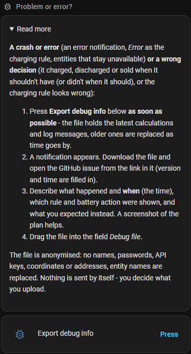

# FAQ and troubleshooting

Start with the plan on the dashboard: every hour has a reason, and clicking it shows the numbers behind
the decision.

## Why doesn't it charge now, although the price is low?

One of these is usually the reason:

- **It doesn't pay.** A grid kWh has to be used later at a price that covers the charge price, loss, wear
  and **min. profit per kWh**. At 0.80 kr with 10 % loss and 0.10 kr wear, the energy has to be used in
  hours above 0.99 kr. See [the cost of a kWh](how-it-works.md#the-cost-of-a-kwh-from-the-battery).
- **There is no use for it.** Only what the house will use (or what can be sold with profit) is charged.
  If the battery already covers the coming expensive hours, nothing more is charged.
- **The sun will fill it.** Grid charging leaves room for the forecast solar surplus.
- **It isn't one of the cheapest periods**, or it costs more than *increase for cheapest price* above the
  day's cheapest hour.

## Why does it charge to the maximum level although it doesn't pay?

If *Recommended full charge every* is above 0 and more days than that have passed since *Last full charge*
(the battery last reached its maximum level minus 1 %), BattMind plans a 💯 [full charge](rules/charging.md#-full-charge)
in the cheapest hours before the end of tomorrow (before the end of today when the full charge is already a
day overdue), whatever *Min. profit per kWh* says. When BattMind has no *Last full charge* and finds none in the
battery level history, the battery counts as a day overdue. It is meant for LFP batteries that need it. Set the
number to 0 to switch it off.

## It planned to charge tonight, but the battery wasn't charged in the morning

Usually the plan changed during the night. BattMind recalculates the plan every few minutes, and it moves
or drops the charging when something it depends on changes:

- **The prices changed.** Forecast prices (e.g. Carnot) and hours filled from the price database are
  replaced by the real prices when they are published, and a cheaper hour – or no profitable one – may turn up.
  The [price forecast analysis](dashboard-analysis.md#price-forecast) shows how far off the forecast usually is.
- **The consumption or the battery level differs** from the forecast, so less (or nothing) was needed.
- **The solar forecast changed.** More expected sun means less grid charging, because solar charges first.

To see what actually happened:

- open the history of `sensor.<prefix>_powerwall_action` (*History* or the entity's dialog): it shows when
  the action was `grid_charging` during the night
- `sensor.<prefix>_current_charging_rule` and its history tell why
- the overview shows the plan as it is now, with a reason for every hour
- [Planned against actual](dashboard-analysis.md#planned-against-actual) in the analysis compares the plan
  from the evening before with what was charged

If the action was `grid_charging` but the battery didn't charge, the automation or the inverter is the
problem – check the blueprint's trace (*Automations → ⋮ → Traces*).

## Why is the action `force_solar_only_charging` in the night?

The energy in the battery is saved for more expensive hours (e.g. the morning or the next evening), or
using it now wouldn't pay for what it cost. The reason is in the plan (⏳ or 🚫).

## Why does it sell less than I expected?

- The sell price is usually much lower than the buy price (tariffs and taxes). Selling only pays when it
  beats using the energy in the house.
- **Min. kWh for export**, **min. total profit** or **excluded sell hours** stop small sales.
- The energy is needed before the battery is charged again.
- In the first days BattMind is still [learning the consumption](how-it-works.md#learning-the-consumption)
  and doesn't sell or block solar charging at all.

## The battery level forecast is wrong

- Check the sign of the **battery power** sensor: positive while discharging. Otherwise enable **Invert**.
- Check whether the **house consumption** sensor includes the battery's charging/discharging, and tell the
  setup. Under *Configure → Home battery* the last page (*check page*) suggests all three from the recorder's
  history: tick *Detect again* to look again after a change.
- In the first days the consumption and solar history is thin. Without long-term statistics for the house
  consumption (`state_class: measurement`) the consumption history starts from the installation. See
  [Forecast accuracy](dashboard-analysis.md#forecast-accuracy) after a week.

## The measured loss is much higher or lower than expected

It is measured with the battery power sensor. A wrong sign, a sensor in kW labelled W, or a sensor that
also includes the inverter's own consumption gives a wrong loss. Check the sensor before you change the
configured loss.

## The solar forecast from Forecast.Solar or Helios Forecast is not used

BattMind reads the forecast that the integration gives the Energy dashboard. When it gets none, the log has a warning
*No solar forecast from forecast_solar (…)* (or `helios_forecast`) with the reason, once until the reason changes,
and the solar surplus is planned from the weather forecast and the stored solar history only (an hour with neither
counts as no sun). Usual reasons:

- the integration's config entry is not loaded (still starting, or its setup failed): check it under
  **Settings → Devices & services**
- Forecast.Solar with several roof planes: one plane listed with the selected one in the Energy dashboard's solar
  source is not loaded. BattMind never uses half a forecast, so it waits for every plane
- the forecast covers no whole hour yet

Hours after the end of the forecast (the free plan of Forecast.Solar covers today and tomorrow) are always planned
from the weather forecast and the history. BattMind does not check how old the forecast is: if the integration stops
updating but still answers, its last forecast is used for the hours ahead it covers (as with Solcast), and values more
than a day old are ignored. Check the integration itself when the forecast looks stale. See
[Forecast.Solar or Helios Forecast](getting-started.md#forecastsolar-or-helios-forecast).

## What happens when prices are missing?

Single hours without a price (e.g. the days after tomorrow without a price forecast) are filled from
BattMind's own price database – the stored prices of the same hour and weekday. They are listed under
*Using offline prices for some hours* in the overview.

If the price integration is down completely, BattMind keeps the last prices for 2 hours. After that it plans with prices from its own price database:
the stored prices of the same hour and weekday. The battery keeps working, and the plan is based on real
prices again as soon as the integration is back. The dashboard shows a warning with a restart button for
the price integration. See [Prices](how-it-works.md#prices).

The database fills up over time, so right after the first installation it has little to go on – unless it
was imported from the PyScript version or a backup.

## The plan isn't recalculated

It is only recalculated when prices, the battery level or a setting have changed. Press **Force planning**
(or call `battmind.enforce_planning`) to recalculate it now.

## The battery doesn't do what the action says

E.g. the action is `grid_charging`, but the battery doesn't charge – after a restart, a lost command or
because the inverter changed its mode by itself. The blueprint's **Repeat interval** (default 5 minutes)
sends the current action again, also when Home Assistant starts, so it is put right within 5 minutes. If you
set it to 0, the action is only sent when BattMind changes it, and nothing catches a lost command. See
[Repeat interval](actions.md#repeat-interval).

If the inverter runs normally although the action is a forced one, the blueprint's
[fail-safe](actions.md#fail-safe) may have ended it: BattMind has not calculated a new action for a while.
The attribute `valid_until` of the action sensor is then in the past, and the log and the charging rule show
why the calculation fails or stopped.

If it still doesn't follow, check the blueprint's trace (*Automations → ⋮ → Traces*): did the actions run,
and did the inverter accept them?

If the inverter can't run the action at all (e.g. it can't block solar charging), select it under
*Configure → Home battery → controllable modes*. BattMind then plans without it. See
[When the inverter can't run an action](actions.md#when-the-inverter-cant-run-an-action).

## Today's charging history looks wrong

Call `battmind.recalc_charging_history_today` (or the button on the dashboard) to recalculate it from the
power values.

## The dashboard shows errors, or a notification says cards are missing

The dashboard uses HACS frontend cards (ApexCharts Card, Mushroom, Config Template Card, Timer Bar Card and, for
styling only, card-mod). When **Dashboard in the sidebar** is on, BattMind looks at the Lovelace resources and
the extra modules of Home Assistant, and a persistent notification lists the cards it can't find, with a link
to GitHub and to the card in HACS.

1. Install the listed cards in HACS and reload the browser page.
2. The notification goes away by itself when the cards are found. The check runs at startup, when the
   integration reloads and when the Lovelace resources change.

If a card is loaded under a name that doesn't contain the card's name (for example a renamed file or a
bundle), the notification can be wrong: dismiss it. It comes back when the list of missing cards changes, the integration reloads or Home Assistant restarts. The
check only reads the resources of your Home Assistant, it never contacts HACS or GitHub. If the resources
can't be read, nothing is reported.

## A database file was corrupt

Before BattMind saves a database, it checks the current file in `/config/.storage/` and copies it to
`/config/battmind_backups/storage/`. It makes one copy a day per database (a restart doesn't make an extra
one) and keeps the newest 3. A damaged file is never copied, so it can't replace the good copies.

If a database file is empty, isn't valid JSON or can't be read at startup (e.g. after a power cut), it is
moved aside as `….corrupt.<time>` and the newest good copy is restored. The log then has an error naming
both files. Data saved after that copy was made is lost, at most about a day. Without a good copy the database is treated as missing, as on a new install. You can then import
a full backup (see [Backup](https://github.com/dezito/BattMind-Integration/blob/main/README.md#backup-export-and-import-of-data)).

## Repairs

BattMind raises a **repair** (*Settings → System → Repairs*) when something it was set up with has gone wrong. The
repairs only read: they never change the battery, the plan or your automations. Each one says what was found and how
to check it, and disappears by itself once the problem is gone. If you ignore a repair, it stays hidden, also after a
restart, until the problem is gone.

- **Sensors BattMind uses are disabled or missing:** a sensor is disabled in Home Assistant, or it no longer exists
  (deleted or renamed). The plan then works with missing values. It disappears when all of them are enabled and found
  again. A sensor that is enabled and has an entity registry entry is not missing, even when its state is unavailable or
  unknown: an unavailable sensor is not this repair. For the house consumption sensor, BattMind posts a persistent
  notification when it stays unavailable (see *The house consumption sensor shows the same value* below). Two minutes
  after each start, BattMind also lists the configured sensors that are still unavailable in a persistent notification.
- **Sensor units BattMind can't read:** a power sensor reports a unit other than mW, W, kW, MW or GW, or the battery
  level sensor reports a unit other than %. A unit with an h at the end (Wh, kWh, MWh) is read as the unit without it,
  so kWh is read as kW. A power sensor with no unit is read as W (the next repair checks that it fits). The repair
  disappears when every such sensor reports a unit BattMind can read.
- **Power sensors without a unit:** BattMind reads a power sensor without a unit in W. The repair is raised when the
  sensor's current value is between -50 and 50 (its absolute value is 50 or less), when its values over the last 3 days (from
  the recorder history) never went above 50 either way, some of them are decimal numbers, there are at least 10 values, and
  at least two different values. Such values look like kilowatts (kW): read as
  W, they are 1000 times too small, and the plan uses far too little power. Fix it at the source: give the sensor its
  unit, for example `unit_of_measurement: kW` on a template sensor. Then run *Test my automation* on the BattMind
  dashboard. The repair is checked every hour: a current value above 50 clears it at the next hourly check, and a value above 50 that is
  only in the history can take about 6 to 7 hours, because the history is read at most every 6 hours and judged at the hourly check. It also disappears when
  the sensor gets a unit. The 10 values are needed only to raise the repair; one value above 50 is enough to clear it.
  Possible false positive: a sensor in W that stays at 50 or below with decimal values for 3 days. If the values really
  are in W, ignore the repair.
- **The battery level looks like a share:** BattMind reads the battery level in %. The repair is raised when the battery
  level's current value is between 0 and 1, and over the last 3 days every value is between 0 and 1, some of them are
  decimal numbers, there are at least 10 values, and at least two different values. Read as %, 0.85 is 0.85 % instead of 85 %. Fix it at the source:
  make the sensor report 0 to 100, for example by multiplying by 100 in a template sensor, and select that sensor under
  **Configure**. The repair is checked every hour: a current value above 1 clears it at the next hourly check, and a value above 1 that
  is only in the history can take about 6 to 7 hours, because the history is read at most every 6 hours and judged at the hourly check. The 10 values are
  needed only to raise the repair; one value above 1 is enough to clear it. Possible false positive: a battery that stays
  between 0 and 1 % for 3 days. If so, ignore the repair.
- **Prices in a subunit, per MWh or per Wh:** a price sensor's unit is a subunit of the currency (øre or cent), per MWh
  or per Wh. BattMind does not convert prices, so the prices are in another scale: 100 times too large (subunit), 1000
  times too large (per MWh) or 1000 times too small (per Wh). A price sensor of Energi Data Service, Energy Price Forecast, the spot forecast
  integrations or the published-price integrations (EPEX Spot, GE-Spot, Nord Pool) in such a unit is not used: the next
  provider or the stored prices fill in. A Strømligning, Octopus Energy or tariff sensor is read as it is, so for those the plan and the savings calculation
  are wrong. Energy Price Forecast's own price per MWh is converted, and Wattcast's price sensor must give ct/kWh. Only the unit is checked. Fix it at the source: in Energi Data Service, turn off the option that shows prices in cent (English
  *Show prices in cent*, Danish *Vis priser i øre*, German *Preise in Cent anzeigen*) and set *Price calculated in*
  (Danish *Pris beregnes i*, German *Preis wird berechnet in*) to kWh in the integration's options. Or select a sensor
  with the currency per kWh (e.g. kr/kWh) under **Configure**. The repair disappears when no price sensor is in a
  subunit, per MWh or per Wh, checked every hour. If the prices really are in the currency per kWh, ignore the repair.
  In the Polish and Ukrainian repair text, the Energi Data Service options are only in English.
- **The automation made from the blueprint is off:** the automation that uses the BattMind blueprint for the battery
  was switched on before, and is now turned off or deleted. A repair is only raised after BattMind has seen that
  automation on, so one you never made from the blueprint, or one kept in another file than `automations.yaml`, never
  gives a repair. It disappears when the automation is on again.
- **The battery does not follow the plan:** BattMind's plan check (see [Does the battery follow the action?](actions.md#does-the-battery-follow-the-action))
  judged at least 24 hours, at least 6 of them did not match the action, and fewer than 80 % matched. The repair lists
  the latest mismatches with the kWh charged and discharged in that hour. Hours in which the battery could not follow
  (at a limit, during the test, with missing data, or when the action changed in that hour) are not counted. Common
  causes: the automation does not run the step for that action (run the test), another app or the inverter's own
  schedule also controls the battery, a sign that is the wrong way round, or an inverter setting such as minimum state
  of charge or maximum power. The hours are counted over the last 14 days, so after a fix the repair can stay for
  several days. It disappears when at least 24 hours are judged and fewer than 6 of them mismatch, or at least 80 %
  match.
- **The house consumption sensor shows the same value:** the sensor that BattMind uses for the house consumption has
  shown the same value for at least 6 hours. The plan then uses an old value for the house consumption. The repair names
  the sensor, the value and since when (local time). The repair appears 6 to 7 hours after the last change, because the
  check runs every hour. Check the integration or device that delivers the sensor, and restart it if needed. Only this
  sensor is checked, because the plan uses it directly; the other sensors are not. A sensor that is unavailable or unknown
  is not judged, and an open repair stays as it is. After a start or reload nothing is deleted or replaced until the first
  check at least 30 minutes later (in practice up to about an hour), so a sensor that is still starting cannot clear the
  repair. After that the repair is deleted when the sensor
  shows another number: at once when the change happens while Home Assistant runs, otherwise at the next check. It is also
  deleted when the sensor is no longer the house consumption sensor of BattMind. If the value really stays the same, ignore
  the repair. A restart does not move the time the repair shows: the saved value keeps the earlier time. An unavailable
  house consumption sensor gets a persistent notification as well. BattMind's `is_entity_available()` (engine/engine.py)
  logs a warning at each call that finds the sensor unavailable. It posts the notification at the first call that comes
  more than 30 minutes after the first call that found the sensor unavailable, and posts it again with the same
  notification id at each later call while the sensor stays unavailable. The states that count as unavailable are None,
  `unavailable` and `unknown`. It needs an entity registry entry of an integration; a YAML template sensor without a
  unique ID gets none.

For the power and battery level repairs, BattMind keeps the list of flagged sensors in its health store, separately for
each repair. A repair goes away when none of its sensors is flagged any more and its list is complete: the list was read intact
from the store, one check judged every sensor of that repair, or the repair had not been raised yet (a fresh start). A
sensor that can't be judged (unavailable, no recorder, too few values) keeps its flag. If the store was lost while a
repair was open, it stays until one check has judged every sensor of it. The
price repair keeps no list: it goes only when every price entity has been judged.

The Strømligning and Solcast sensors have their own repairs (see [Getting started](getting-started.md)). The check runs
at startup, every hour, a minute after a sensor was enabled or disabled, when the blueprint automation changes, and when
the plan check is published again.

## Report a problem

When BattMind does something wrong, create a debug file **as soon as possible** after it happened: it holds
the latest calculations, the inputs they ran with and the latest log messages.

1. Press the button **Export debug info** at the bottom of the dashboard's **Settings** view (under *Problem or
   error?*) or on the BattMind device (Settings → Devices & services → BattMind),
   or run the action `battmind.export_debug` under **Developer tools → Actions**.
2. A notification appears with a download link (valid for 24 hours) and a link that opens a GitHub issue with
   the version and time filled in. The file is also saved in `battmind_debug/` in the config folder (the
   newest 5 per instance are kept).
3. Describe what happened, when it happened and what you expected, and drag the `.json.gz` file into the
   field *Debug file*.

<p align="center">
  
</p>

### What is in the debug file

What's in the file is there so the problem can be found and the calculation replayed:

- the configuration and the settings (switches, numbers, selects)
- the state of the entities BattMind uses and of its own entities, including the plans and the overview
- the last 50 calculations with the charging rule, errors and tracebacks
- the automations made from the bundled blueprint (*BattMind - control the home battery*): their inputs (the actions you set up for your inverter),
  whether they are on and when they last ran, and the installed blueprint file when it differs from the
  bundled one
- for the entities BattMind and the blueprint automations use: the integration (e.g. `huawei_solar`,
  `fronius`, `zaptec`), the device's manufacturer, model and firmware, the integration's version and whether
  it is loaded
- the inputs of the last 2 calculations and of the last calculation that failed (states, history, prices,
  weather/solar forecast)
- the internal state and the databases (charging history, power values, price history, analysis)
- the last 1000 log messages of BattMind, and the end of the diagnostic file log when it is turned on
- the BattMind and Home Assistant versions and the time zone

### What is not in the debug file

Everything is anonymised before the file is written:

- **Passwords, API keys, tokens and secrets**: BattMind doesn't use any, and every value under a key with
  `password`, `token`, `secret`, `api_key` or `webhook` in its name is removed. `secrets.yaml` is never read.
- **Names**: names of people, Home Assistant users, the home (its name in Home Assistant) and notify services
  become `<redacted>`, also inside log messages and texts.
- **Entity names**: entity ids of other integrations are replaced by the setting or blueprint input they are used for, e.g.
  `sensor.power_consumption` instead of `sensor.my_house_consumption`; other entities become `sensor.entity_1`
  and so on. BattMind's own entities (`sensor.<prefix>_...`) are kept. Friendly names are removed.
- **Location**: Coordinates are rounded to whole degrees (about 100 × 60 km), and sunrise/sunset times to 5
  minutes. Addresses, streets, cities and postal codes are removed.
- **Contact and network details**: e-mail addresses, URLs and IP addresses are removed everywhere, also in log
  messages. Phone numbers, MAC addresses and host names are removed from entity attributes.
- **Device identifiers**: VIN and serial numbers in entity attributes are removed. Of devices only the
  manufacturer, model and firmware are exported: not their names, serial numbers or identifiers, and not the
  names of integration entries.
- **Services**: service names such as `number.set_value` or `zaptec.limit_current` are kept, so the blueprint
  actions can be read; notify services and scripts are named after your things and are replaced.

What remains is your energy data (consumption, prices, plans and history) and how your setup is built
(blueprint actions, integrations and device models). Open the file (it is gzip
compressed JSON) if you want to check it before you upload it. BattMind never sends anything by itself; the
file only leaves your Home Assistant when you upload it.

## Logs and debug info

- Turn on **Diagnostic file log** under **Configure → Advanced**. The log is written to
  `battmind_<prefix>.log` in the config folder (2 MB, 3 rotated files).
- Or enable debug logging in `configuration.yaml`:
  ```yaml
  logger:
    logs:
      custom_components.battmind: debug
  ```
- Call `battmind.debug_info` under **Developer tools → Actions** to see the internal state as a
  notification. It is **not** anonymised, so don't post it; use the debug file from
  [Report a problem](#report-a-problem) for issues.
