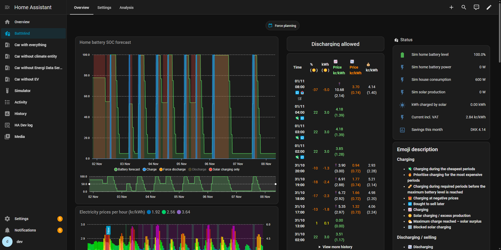

# Getting started

This page takes you from installation to a battery that BattMind controls. Plan about 30 minutes, and a
few days of watching the plan before you trust it.

## 1. Check what you need

| You need | Why |
|---|---|
| A **battery level** sensor (%) | where the plan starts from |
| A **battery power** sensor (W or kW) | measures what goes in and out (charging history, cost price, loss) |
| A **house consumption** sensor (W or kW) – the house's consumption, not the grid import | the consumption forecast per hour |
| [Energi Data Service](https://github.com/MTrab/energidataservice), [Strømligning](https://github.com/MTrab/stromligning), [Energy Price Forecast](https://github.com/BackupBaTTerY/energypriceforecast-home-assistant) and/or a spot forecast integration, EPEX Spot, GE-Spot, Octopus Energy or Nord Pool | buy and sell prices per hour |
| A way to control the inverter from Home Assistant | BattMind only decides – your automation does it |

Optional, but recommended with solar panels:

- a **solar production** sensor (W or kW)
- a solar forecast: [Solcast PV Forecast](https://github.com/BJReplay/ha-solcast-solar),
  [Forecast.Solar](https://www.home-assistant.io/integrations/forecast_solar/) (built into Home Assistant) or
  [Helios Forecast](https://github.com/ReikanYsora/Helios-Forecast)
- a weather integration with `weather.get_forecasts` (Met.no, AccuWeather, OpenWeather …)

For the dashboard you need the HACS frontend cards `apexcharts-card`, `mushroom`, `config-template-card`, `timer-bar-card`
and `card-mod`. If Home Assistant can't find some of them, a notification lists the missing ones with links to install
them (see [the cards are missing](faq-troubleshooting.md#the-dashboard-shows-errors-or-a-notification-says-cards-are-missing)).

> [!TIP]
> Before you start, find out how your inverter is controlled: which entities or services set forced charging,
> forced discharging and the max. charge/discharge power. Look under *Developer tools → Actions* and *States*
> for your inverter integration. You need them in [step 5](#5-control-the-battery).

Optional for additional battery protection: a battery temperature sensor. The inverter/BMS remains the
primary safety system.

## 2. Install

1. Open **HACS**, search for **BattMind**, install it, and restart Home Assistant.
2. **Settings → Devices & services → Add integration → BattMind**.

Not in the HACS search? Add it as a custom repository first: **HACS** → ⋮ → **Custom repositories** →
`https://github.com/dezito/BattMind-Integration` with type **Integration**, then search again.

## 3. Go through the setup

The setup is split into small pages. Every field has a help text – here are the ones that matter most.

### Prefix and language

The prefix starts every entity id: with `battmind` you get `sensor.battmind_powerwall_action`. Use one
prefix per battery. If the [PyScript version](migration.md) still runs, choose another prefix (e.g.
`battmind_ha`).

The language is used for the entity names, the dashboard, the charging rule and notifications. It can be
changed later under **Configure → General**; the entry reloads and the entity names follow (names you
renamed yourself are kept).

The optional **sidebar icon** is the icon of the dashboard in the sidebar (default `mdi:home-battery`). Pick another
one, e.g. `mdi:solar-power`, to tell several instances apart. It can be changed under **Configure → General**;
leave the field empty for the default icon.

### Home battery – sensors

When you set up BattMind, the solar power and battery power fields are pre-filled from the Energy dashboard of Home
Assistant 2025.12 or newer. Each field is filled only when the dashboard has exactly one source of that kind (solar or
battery) and that source has a power sensor, and not when another BattMind entry already uses that sensor. For an inverted or two-sensor battery, the battery
field gets the sensor that the Energy dashboard generates for it; that sensor disappears if the
Energy configuration is changed. They are only suggestions: you can pick another sensor, or clear the solar field. The
battery power field is required, so it can be changed but not cleared. The battery sign is still read from the recorder.

- **Battery power:** BattMind expects **positive while discharging, negative while charging**. If your
  sensor is the other way round, **Invert** should be on; the [check page](#check-the-battery-and-consumption-settings)
  suggests it from the recorder.
- **Battery temperature:** optional. When selected, BattMind requests `battery_stopped` outside the safe
  range and while the sensor is unavailable. Configure **Stop battery** in the control blueprint first.

### Home battery – specifications

| Field | How to set it |
|---|---|
| Battery size | the **usable** capacity in kWh |
| Min. level | the reserve BattMind never plans below (e.g. 5–10 %) |
| Max. level | the highest level BattMind charges to (usually 100 %) |
| Charge / discharge power | the battery's max. power in W – limits how many kWh fit in an hour |
| Charge/discharge loss | the **round trip** loss as a fraction: 0.1 = 10 %. A typical lithium battery with inverter loses 8–15 % |
| Loss from history | after 6 full cycles BattMind measures the loss itself – leave it on |
| Charging / discharging efficiency curve | optional object mapping AC power in W to efficiency in percent, e.g. 1000 W = 88 %, 3000 W = 94 %, 5000 W = 96 %. BattMind interpolates between points. Leave empty to let BattMind measure the curve itself (the round-trip loss is used until there are enough measurements) |
| Enhance battery efficiency | switch under **Settings → Control** that decides whether BattMind uses the configured curves. Turning it off keeps the curves and uses the round-trip loss instead |
| Min. / max. safe temperature | limits in °C from the battery manufacturer; defaults are 0 to 50 °C |

The loss and the wear (on the page *Refund and fees*, see [prices](#prices)) decide how big a price difference has
to be before BattMind uses the battery. See [How BattMind plans](how-it-works.md#the-cost-of-a-kwh-from-the-battery).

### Home battery – controllable modes

Leave everything unselected if your inverter can run all the [actions](actions.md#the-six-actions). If it
can't run one of them, e.g. it can't block solar charging or sell from the battery, select it under
**Modes the battery can't run**. BattMind then never plans that action, and the rules that need it count as
off and are hidden on the dashboard. See [When the inverter can't run an action](actions.md#when-the-inverter-cant-run-an-action).

### Consumption

- **House consumption:** the house's own consumption. Whether the sensor includes the battery's charging or
  discharging is set on the [check page](#check-the-battery-and-consumption-settings), so it isn't counted twice.
- **Ignored consumers:** power sensors subtracted from the house, e.g. the EV charger. They aren't in the
  forecast, so the battery isn't planned to cover them. The house consumption used for the solar surplus is never below 0 W.
- **Ignore Cable Juice Planner chargers** (on by default): with [Cable Juice Planner](cookbook.md#together-with-cable-juice-planner-ev)
  installed, BattMind also subtracts the charger power of every car you have set up there, so you don't add
  them to the list yourself. The page shows the chargers it found. A car added later is picked up
  automatically (BattMind reloads once), and a charger that is also in your list is subtracted once. A car whose
  charger has its own meter (*House consumption includes this car's charger* off in that car's Cable Juice Planner
  settings) is left out, also when that setting is changed later: the house consumption sensor doesn't measure it, so
  there is nothing to subtract, and don't add it under *Ignored consumers* either (that would take consumption that
  was never there out of the forecast). BattMind never adds a charger that the sensor doesn't measure, whatever this
  switch says: if the home battery also supplies such a charger, the forecast is too low for it, so use a house
  consumption sensor that includes the charger then. Turn this switch off if the house consumption sensor includes
  none of the chargers, e.g. a separate meter: subtracting them would then take consumption that was never there out
  of the forecast. For a single car on its own meter, turn off *House consumption includes this car's charger* on that
  car in Cable Juice Planner instead.
- **A charger that hangs:** A Cable Juice Planner charger that has not reported for over 30 minutes while it still reads a number other
  than 0 (a hung integration is not *unavailable*) is taken to be stuck: it is not subtracted, in the current hour and in the
  hours since it got stuck, until it reports again, and a warning is logged. The higher consumption is the safe side. It is the
  report time that counts, not the value, so a charger that holds a steady value is fine as long as it keeps reporting; the
  other ignored sensors are always subtracted, whatever they report.

### Check the battery and consumption settings

After the sensors for the battery and the house consumption, BattMind looks at the history the recorder has for the battery and the house consumption – as far back as it takes,
up to a few weeks – and suggests three settings, with the numbers it used so you can see that they fit:

| Setting | How it is found |
|---|---|
| **Invert** (battery power sign) | an unbroken stretch of 1–3 hours in which the battery level rises while the power has one sign: that sign means charging |
| **Consumption includes charging** | at the moments the battery starts or stops charging, the house consumption steps by about the charging power (a sensor from grid and solar) or does not step (the total load of the house) |
| **Consumption includes discharging** | at the moments the battery starts or stops discharging, the consumption does not step (the total load, which the battery covers) or falls by about the discharge power (a sensor from grid and solar) |

Only the minutes around each start and stop are compared, so a load that is different in the evening than at night, or an
EV that charges in the same hours but starts and stops at other moments, does not count. One start or stop is not enough:
at least four of the latest must agree, and in practice a few days of history are needed. A consumer that starts and
stops in the same minutes as the battery and is about as big (an EV or a heat pump on the same cheap-hour schedule) can fake
one direction: the charging and the discharging must therefore tell the same story – a sensor of the total load (does not
include the charging, includes the discharging) or one from grid and solar (the opposite) – and both must be decided,
otherwise nothing is suggested. Add such a consumer under *Ignored consumers* and look again to get a suggestion. Two
such consumers, one for each direction, can still fake both – check the numbers. A sensor that includes both or
neither direction is never suggested: set it by hand. Each answer needs only a short stretch of unbroken history – a
stretch of an hour or two, or about 25 minutes around a start or stop – but it may be days or weeks back if that is where
the history is clear. A battery that sells to the grid, a load that follows the battery, or a sensor that never changes
leaves the answer open.

The brackets show what an answer rests on: **h** = hours of unbroken data, **n** = the number of starts and stops
compared, and how far back it was found (for example `n=4, -2 d`). ✅ means on, ⬜ off and ❔ that the history could not
decide it: the current value is then kept, never a guess. Everything can be changed, and nothing is saved before you
continue. The suggestions are only made when you have chosen or changed one of the three sensors in the flow, so a
restored backup, an import from PyScript and the stored settings keep their values; tick *Detect again* to look again
(the page is the last one of *Home battery* and of *House consumption* under *Configure*). The numbers are only suggestions – check that they fit before you continue.

The consumption numbers are read after the consumers that the forecast itself leaves out are subtracted (the ignored ones and, when the switch above is on, the chargers of Cable Juice Planner), so
the page compares what the planner works with. If the page shows a message instead of numbers (no recorder, the reading took
too long, a power sensor with an unknown unit, no usable history), the current values are kept; tick *Detect again* to try
again.

### Prices

First comes the **country** of the prices (Home Assistant's country is suggested; a restored backup or an import shows its
own). It can be changed later under **General** next to the language. A new entry outside Denmark starts with Energy Price
Forecast. The price provider page lists only the providers that have prices in the country and names the ones it leaves out;
changing the country under **General** leads on to the price pages when a chosen provider has none in the new one. Strømligning
only works in Denmark, Energi Data Service in Denmark, Norway, Sweden, Finland, Estonia, Latvia, Lithuania, France, the
Netherlands, Belgium, Austria, Germany and Luxembourg, and Energy Price Forecast in most of Europe.

The page has two sections: **📈 Prices and forecast**, and **🕐 Prices only (today and tomorrow)** with EPEX Spot, GE-Spot,
Octopus Energy and Nord Pool, which need a provider from the first section next to them. At the top it shows the order the
prices are taken in, with the providers of your country, and each section lists them in that order.

A price page sent without a required sensor stays and marks the field. If you don't have the sensor (for example because
the integration is not set up), send the page again without it: that goes back to the price providers, with what you
filled in kept. To choose another country during the first setup, close the setup and start again.

Choose one or more. With several, the priority is Strømligning,
then Energi Data Service, then Octopus Energy, Nord Pool, EPEX Spot and GE-Spot, then Energy Price Forecast, then the spot forecast integrations: each hour uses the first one that has a price (a real price
always goes before a forecast), and the next fills the gaps (also in the what-if and the analysis). All price sensors must be in the same currency
(a backup provider in another currency is refused).

**🧪** before a name means that the provider is **not confirmed with real data** in your country yet. See [Tested integrations](tested-integrations.md) for
which are confirmed, by country. The others can be chosen too; check their prices after the setup.

With every price update the integration also tests each chosen provider on its own prices: the unit, whether the buy and
sell prices are complete from the current hour to the end of today and for tomorrow, and how many days the forecast reaches.
The result is in the attribute `price_check` of `sensor.battmind_powerwall_action` (the raw values are under **Developer tools → States**).
The dashboard shows them under **Settings → Price check**; click *Show the price check* to open it (✅ passed, ❌ failed,
➖ empty). `true` is passed, `false` failed, and an empty value could not be judged:
- tomorrow's prices before 20:00, so `ok` is normally empty until they arrive,
- a sensor of the provider that is unavailable,
- no sell sensor and no sell prices: `ok` then never becomes `true`, except with Octopus Energy without an export tariff.

At the bottom of the section is the link **Price Provider Verification Report (Confirmed)**. Use it when you have seen a provider work with your real data and the
amounts are right. It opens a new, public issue on GitHub, filled in with the providers (the ones not confirmed yet, or all
chosen ones when all are confirmed), the country, the versions and the results of the check, but no sensor names, prices or
other data of yours. Clicking the link sends these fields to GitHub; nothing is published until you submit the issue there. A report does not confirm a provider by itself.

In a market without published prices for the next day, tomorrow shows `false` in the evening. A passed test says that the
prices are there, not that their amounts are right, and no price or plan depends on it.

**Spot forecast integrations** (wholesale prices with a forecast, for markets where no retail price sensor exists):
[Spot Forecast](https://github.com/cygnusb/ha-spot-forecast) (Germany, Luxembourg, the Netherlands and Southern Norway; Denmark
is left out, Energi Data Service and Strømligning are better there), [Elprisprognos](https://github.com/AlexAsplund/ha-elprognos)
(Sweden) and [Wattcast](https://github.com/SectorTll/wattcast-homeassistant) (Finland, Estonia, Latvia, Lithuania; it gives
ct/kWh, the only subunit that is accepted, and needs its forecast sensor too). They give the exchange price, not a price a household pays.
The buy price is made from it: **spot price × (1 + VAT) + surcharge**, where the VAT (%) and the surcharge per kWh (grid fee,
taxes and the supplier's margin, with VAT) are asked on the fee page and have **no default**: without them there are no prices,
because a surcharge of 0 would make every buy price too low. The sell price is the spot price less the sell fee. A flat surcharge
cannot follow a grid tariff that changes through the day, so the plan is less exact than with a retail price. The price page refuses a sensor that has price rows but none of them
published (it is probably not the price sensor of the integration) and a price per MWh or Wh. The recorded history
of these sensors is not used (their state is a wholesale price): BattMind stores their published prices in its own price history,
which fills hours that have no price, but the what-if has no history for them (it needs Energi Data Service, Strømligning or
Energy Price Forecast in the setup too). Elprisprognos only keeps today's coming hours in its list.

**Providers of your own published prices** ([EPEX Spot](https://github.com/mampfes/ha_epex_spot), [GE-Spot](https://github.com/enoch85/ge-spot),
[Octopus Energy](https://github.com/BottlecapDave/HomeAssistant-OctopusEnergy) for the United Kingdom and [Nord Pool](https://github.com/custom-components/nordpool)
from HACS): their sensors already have the VAT, the surcharge and the fees you set up in them, so the **buy price is what the sensor says**
(no VAT or surcharge of ours is asked for). They give today and tomorrow and **no forecast**, so each works only next to a provider with a
forecast (Energy Price Forecast, Energi Data Service with Carnot, or a spot forecast integration), and they come **before the estimating
providers** in the priority: the days after tomorrow come from the other provider's own formula, so the level can step between tomorrow and
the day after. The price chart of the dashboard (the same for every provider) shows 7 days in one chart: the prices the plan is made on, the
published ones and, shaded from the first forecast period on, the forecast for the rest (tomorrow is shaded until its prices are out); it follows the price updates (about once an hour), not every minute. A forecast
price is the forecast provider's price with its small adder per day ahead and the measured correction; the sell series is the sell price the plan has
(the wholesale price less the sell fee, or one from the price history where no provider has one), not what a fixed solar sell price settles. The **sell price** is the wholesale price less the sell fee: EPEX Spot's *Market Price* sensor (its *Total Price* sensor is
the buy price), a second Nord Pool sensor without VAT and costs (add the integration twice, the second with VAT off), GE-Spot's `raw_value`
(only from a source that has a market price, not Strømligning or Amber; tomorrow's rows only once tomorrow is complete) and Octopus Energy's export rates
(optional: without an export tariff a sale is worth nothing in every hour, also in the days after tomorrow that another provider fills, never the buy price). The page refuses a sensor in cents or øre or per MWh or Wh,
a sensor without price rows (Home Assistant's own Nord Pool has none), the same sensor as buy and sell price, a sensor in the wrong field (EPEX Spot's
Market Price and Total Price swapped, an Octopus Energy import event as export or the other way, a gas event) and EPEX Spot's sources Tibber and Energyforecast.de, whose price is not
the exchange price. Octopus Energy's rates are in pounds: a rate above 5 is taken for pence and gives no prices. A price page with its sensors
asks for no VAT and surcharge; those are only for the wholesale prices of the spot forecast integrations.

- **Energi Data Service:** enable *Carnot* in Energi Data Service to plan beyond the published prices.
  Without a separate sell sensor, the buy price minus tariffs is used as sell price. A sell sensor
  without tariffs is used as the spot price; the net and system tariff paid when selling then come
  from the buy sensor.
- **Energy Price Forecast** (for prices outside Denmark): choose its retail price sensor (*Current retail price*) as
  the buy price – it gives the published prices of today and tomorrow and the forecast after them. It only exists when
  retail pricing is turned on in Energy Price Forecast: its estimate (Germany, the Netherlands, Denmark, Austria and
  Norway) or your own formula (every market). In a market where Energy Price Forecast publishes no prices, only a
  forecast (Finland, Great Britain, SE1/SE2 and others), set a Nord Pool or ENTSO-e sensor as its own price source
  and use its own retail formula: the page refuses a buy or sell sensor with only a forecast for today, and an existing setup gets a repair when one has had only a forecast for at least an hour. Choose its wholesale price sensor
  (*Price forecast series*) as the sell
  price (required: the retail price is higher than what a sale pays, so it is refused as a sell sensor; an entry
  restored from a backup without one sells at the buy price less the sell fee). The sensors must give the
  price per kWh in the currency (EUR/kWh, GBP/kWh, …), not in cents or pence: BattMind refuses a sensor in
  ct/kWh or p/kWh, and one whose unit is changed to that later gives no prices (a repair names it). A sensor in EUR/MWh (a wholesale sensor often is) is converted to kWh, also in the recorded history (read in the unit the sensor has now: if you change its unit, the old history is off by 1000 (MWh) or 100 (ct); a sensor that is missing from Home Assistant has its history left out).
- **Strømligning:** the buy sensors are required. The sell sensors and the tariff page give an accurate
  sell price: Strømligning's sell price includes every tariff, so the distribution (transport) tariff,
  net tariff, system tariff, electricity tax and surcharge are all subtracted. The distribution sensor
  only has today's tariffs; other days use the same time of day from the latest known day.
  Strømligning switches its sensors excl. VAT (which the sell sensors and the tariffs use) off by default,
  and a disabled sensor can't be selected: enable them first under **Settings → Devices & services →
  Entities** (*Show disabled entities*). The price forecasts also need *Include price forecasts for the next week?* in
  the Strømligning options. If a sensor BattMind uses is disabled later, or Strømligning stops providing it, a
  **repair** names it. Until it is fixed a missing tariff counts as 0, which makes the sell price too high.
- **Refund** is subtracted from the buy price. Selling costs the **sell fee** (what the buyer of your electricity charges for buying it) plus Energinet's net
  and system tariff:
  sell price = price − the tariffs and taxes in it − (sell fee + net tariff + system tariff).
  The price charts on the dashboard show the same sell price.
- **Wear per kWh:** battery price ÷ expected lifetime in kWh, e.g. 40 000 kr ÷ (10 kWh × 6000 cycles) ≈ 0.67 kr/kWh.
  It is on this page because it is an amount in the currency of the prices: a new installation suggests 0.10 kr in
  that currency (0.013 € with euro prices). A higher value makes BattMind more careful.

### Solar panels and weather (optional)

First comes the **solar forecast** you use, on a page of its own (**No forecast** without solar panels or a forecast): Solcast
PV Forecast, **🧪** Forecast.Solar or **🧪** Helios Forecast. 🧪 means **not confirmed with real data** yet; so far Solcast PV
Forecast is confirmed. The next page is made for the chosen forecast, with its own title, explanation and sensor field. Its
picker offers only that forecast's sensors (all three when the integration of a stored sensor is not known); leave the field
empty to choose the forecast again. The choice is not stored: it is read from the sensor. When the stored sensor is not
recognised as one of the three forecasts, nothing is chosen for you. Choosing another forecast removes the stored sensor
(a sensor whose integration is not known is kept).

The Solcast page lists the Solcast sensors that are not ready. If you choose a sensor there whose list is different, the
page is shown once more with the new list; send it again to continue. In a new setup it checks all seven days, because the number of days to plan is chosen later.

With a forecast the dashboard shows **Settings → Solar forecast check** (click *Show the solar forecast check*): the source,
and for each day how many hours the forecast delivers a value for, and their sum in kWh (the attribute
`solar_check` of `sensor.battmind_powerwall_action`). It judges nothing: compare it with your forecast integration. Some forecasts give no value
for hours without full daylight, so fewer than 24 hours is not an error by itself.

At the bottom of that section is the link **Solar Forecast Verification Report (Confirmed)**. Use it when you have seen the
forecast work with real data and the values match. It opens a new, public issue on GitHub, filled in with the source, the versions, the time of the check with its time zone offset, the dates and the number of hours per day. It holds no
kWh and no sensor names. Clicking the link
sends these fields to GitHub; nothing is published until you submit the issue there. A report does not confirm a source by
itself.

Leave the page empty without solar. With solar:

- **Inverter's max. power:** limits solar and battery power together.
- **Fixed solar sell price:** −1 uses the hourly sell price. Set a price if your production agreement pays
  a fixed price and settles the difference to the spot price – see [Fixed solar sell price](rules/solar.md#fixed-solar-sell-price).
- **Solcast:** select e.g. `sensor.solcast_pv_forecast_forecast_today`. The other days are found automatically,
  but Solcast switches the forecast sensors of day 3 and on off by default: enable `…_forecast_day_3` and on
  for as many days as you plan (**Settings → Devices & services → Entities**, *Show disabled entities*), and keep
  *Hourly detail* on under *Forecast attributes breakdown* in the Solcast options. A **repair** lists the sensors that are disabled, named
  differently or without hourly detail; the days without Solcast are planned from the weather forecast and
  the stored solar history.
- **Forecast.Solar or Helios Forecast:** see [Forecast.Solar or Helios Forecast](#forecastsolar-or-helios-forecast)
  below.
- **Weather:** the hourly and daily forecast. Together with the stored solar history per weather type it
  gives a solar forecast that learns your roof – also without a forecast integration.

#### Forecast.Solar or Helios Forecast

Instead of Solcast you can choose
[Forecast.Solar](https://www.home-assistant.io/integrations/forecast_solar/) or
[Helios Forecast](https://github.com/ReikanYsora/Helios-Forecast) on the solar forecast page; the next page then takes a sensor of that integration. BattMind reads the hourly forecast these
integrations give the Energy dashboard of Home Assistant, not the state of the sensor, so any sensor of the
integration works:

- **Helios Forecast:** e.g. `sensor.helios_forecast_power_now`. Helios learns your roof from your production, so
  give it your solar production sensor in its own setup.
- **Forecast.Solar:** any sensor of it, e.g. `sensor.energy_production_today`. Forecast.Solar has one entry per roof
  plane. If you added the planes as the forecast of a solar source in the Energy dashboard
  (**Settings → Dashboards → Energy**, the solar panels), every plane of that source is added up; otherwise only the
  plane of the selected sensor is used. An hour that one of the planes does not cover gets no forecast at all
  (never half of one), and while a plane is not loaded the whole forecast waits for it. A plane you disabled is left
  out.
- The free plan of Forecast.Solar covers today and tomorrow. BattMind plans the hours a forecast does not cover (and
  any hour while the integration has no forecast) from the weather forecast and the stored solar history, the same
  as without a forecast integration. An hour with neither counts as no sun.
- Only whole hours are used: the hour of the first sunrise in the forecast and an hour at the end of the forecast that
  is only covered in part are planned the same way.
- Helios Forecast sums its own forecast points per hour. If it had to drop some of them, the hour looks complete to
  BattMind and is too low.
- The forecast counts 75 % and the stored solar history 25 %, as with Solcast (see
  [How it works](how-it-works.md#solar-forecast)). Forecast.Solar does not learn from your production; Helios does,
  so with Helios your own production counts in both parts.
- The Solcast repair does not apply to these integrations, and the solar forecast in the price charts of the
  dashboard is drawn only for Solcast.

### Storm warning (optional)

Under **Configure → Solar panels, weather and storm warning**. Choose MeteoAlarm's binary sensor to keep the
battery charged for a storm warning, or leave it empty (default) and the function, its sensor and its number are not
made. See [Storm warning](rules/storm.md).

### Push notifications (optional)

Under **Configure → Push notifications**. Choose the notify services or notify entities that should get the messages (for
example the mobile app: `notify.mobile_app_<phone>`). With none chosen (default) nothing is sent. All four categories below are on by default, so choosing a service is enough; switch off
what you do not want. The messages are in the
language you chose for BattMind. BattMind only informs; it controls nothing, and the messages go only to the services you chose.

A message is sent when something **changes**, never on a timer:

| Category | Message | Sent when |
|---|---|---|
| Problems | Battery level lost | the battery level sensor has given no number for 2 hours (the plan then assumes a full battery) |
| | The plan is not followed | the repair *plan not followed* is raised (see [Troubleshooting](faq-troubleshooting.md)) |
| | Sensors missing | the repair *entities missing* is raised (the battery level sensor is left out: *battery level lost* says it) |
| | House consumption frozen | the repair *consumption frozen* is raised |
| | Sensors unavailable | the house consumption or the battery power sensor has been unavailable for more than 30 minutes (checked hourly; the prices, the solar sensors and the battery level, which has its own message, are not part of it) |
| | The battery is stopped | the battery temperature is out of range, or unavailable, for 15 minutes |
| | Could not start / the plan cannot be calculated / the charging history fails | BattMind stops while starting, the plan fails three times in a row, or the history of an hour cannot be saved after three tries |
| Storm warning | Storm warning | a storm warning is coming or going on (once) |
| Learning finished | Consumption, efficiency, capacity | once each: the consumption forecast has enough history, the efficiency curves are measured, the usable capacity is measured |
| Daily summary | Plan for tomorrow | once a day, at the end of the first hour from the one you choose in which tomorrow's prices are all known: grid charging (kWh and hours), sale, the battery level now |

- **When it is over.** A problem is followed by a message when it is over, with the same tag, so it replaces the problem on the
  phone. "Over" is only said when BattMind positively knows; missing or unclear data says nothing.
- **Not flapping.** Some conditions have to hold for a while before the message goes (15 minutes for the temperature), and have to be
  over for a while before "over" goes (5 minutes for the battery level, 10 for unavailable sensors and a failing plan, 15 for the
  temperature, 30 for the storm), so a value that flaps around a limit sends one message, not ten.
- **Once.** What BattMind sent is remembered (in `.storage/battmind.<entry id>.notices`), also after a restart, so a problem that
  goes on is not sent again. A message that could not be delivered (the mobile app registers its service a little after Home
  Assistant has started) is tried again every 5 minutes until a service takes it.
- **Learning.** What is already learned when you turn the messages on, or after an update, is not announced; a message comes when it
  becomes ready later. A measurement that starts again (a new sensor or battery size) can send it again.
- **The summary** shows the plan as it is now: it changes with the prices and the forecast. It is not a promise and shows no savings.

### Planning (advanced)

| Field | Default | Meaning |
|---|---|---|
| Days to plan | 7 | the plan covers today and the next days. More days give better decisions about saving energy for later, but cost more CPU and rely on price forecasts |
| Interval | 5 min | how often the plan is checked. It is only recalculated when prices, battery level or settings have changed |
| Dashboard | on | a ready-made dashboard in the sidebar |
| Diagnostic file log | off | writes `battmind_<prefix>.log` in the config folder, for [troubleshooting](faq-troubleshooting.md) |

The last page of the setup, **Database**, sets how much history BattMind stores.

Everything can be changed later under **Configure** on the integration.

## 4. Look at the plan

Open the **BattMind** dashboard in the sidebar:

  

- **Overview** shows the battery level forecast, the prices and the plan with a reason for every hour.
  Click a row in the plan to see the numbers behind it.
- **Settings** has all the rules. They are all on by default, and the
  [whole period optimisation](rules/optimizer.md) controls the battery.

Give it a day or two. At the first start BattMind reads the consumption of the last days from Home
Assistant's long-term statistics, and the forecast gets better as it stores the consumption per hour. The
solar forecast gets better as it stores the solar surplus per weather type. Until there are 3 days of
consumption history, BattMind doesn't sell from the battery or block solar charging, see
[Learning the consumption](how-it-works.md#learning-the-consumption).

## 5. Control the battery

BattMind only sets `sensor.<prefix>_powerwall_action`. The automation that makes the inverter follow it is
yours. The easiest way is the blueprint that comes with the integration:

1. *Settings → Automations & scenes → Blueprints* → **BattMind - control the home battery** → **Create automation**.
2. Select the BattMind sensor.
3. For each of the six actions, add what your inverter should do. See [Actions](actions.md) for what each
   action means, and the [inverter pages](README.md#inverters) for complete examples
   ([Huawei Solar](inverters/huawei.md) is the tested one).
4. Keep **Repeat interval** at 5 minutes (default): the action is sent again, so a lost command or a mode
   the inverter changed by itself is put right. Use 30 seconds for a battery controlled via Modbus.

> [!TIP]
> Start with the automation **off** and watch `sensor.<prefix>_powerwall_action` for a day. When the actions
> look right, turn it on. After a day with the automation on, check the attribute `plan_check` of the action
> sensor: it shows whether the battery did what the actions asked (see
> [Does the battery follow the action?](actions.md#does-the-battery-follow-the-action)). The hours from the day
> with the automation off count as mismatches for 14 days, so look at `latest_mismatches` and the hours since you
> turned it on.
>
> Don't want to wait for the plan to use every action? Turn the automation on and run **Test my automation**
> under *Settings* on the dashboard: it publishes each action in turn and shows which ones the battery follows
> (see [Test your automation](actions.md#test-your-automation)). It charges the battery from the grid and
> discharges it to the grid for a few minutes.

## 6. Next steps

- [What-if simulator](what-if-simulator.md) - replay your history with another battery, controller (rules or optimisation) or planning settings

- [How BattMind plans](how-it-works.md) – the model behind the decisions
- [Recipes](cookbook.md) – settings for typical setups
- [Dashboard and analysis](dashboard-analysis.md) – how to see what the battery earns
