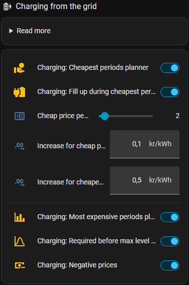

# Charging from the grid

These rules decide when the battery charges from the grid. All of them:

- only charge what can be **used or sold with profit** after loss and wear (see
  [the cost of a kWh from the battery](../how-it-works.md#the-cost-of-a-kwh-from-the-battery))
- follow the [profit requirements](selling.md#profit-requirements)
- leave room for the **solar surplus** – grid charging never takes charge power or battery room the sun
  will use, unless that solar is sold for more than the grid kWh costs

The [full charge](#-full-charge) is the exception to the first two: it charges for the battery's health,
not for profit, so it ignores *Min. profit per kWh*.

With the [whole period optimisation](optimizer.md) on, the switches decide which kinds of charging the
optimisation may use. The optimisation also values the energy left in the battery at the end of the period,
so it can charge for energy that is only used after the period (see
[Whole period optimisation](optimizer.md#what-it-does)).

The examples below use 10 % loss and 0.10 kr/kWh wear: a grid kWh at price *p* costs `p × 1.11 + 0.10` out
of the battery.

  

---

## 💸 Cheapest periods

**Switch:** *Charging: Cheapest periods planner* · **Numbers:** *Cheap price periods* (default 2),
*Increase for cheap periods* (default 0.10 kr), *Increase for cheapest price* (default 0.50 kr)

Charges the battery in the day's cheapest periods for the day's consumption.

1. In the day's prices (for the coming days also from 18:00 the evening before) BattMind finds the
   **cheap price periods**: the lowest points of the price curve, e.g. the night and the middle of the day.
2. A period is extended with the following hours that cost at most **increase for cheap periods** more than
   the lowest point. Charging is planned backwards from the end of the period.
3. Hours that cost more than **increase for cheapest price** above the day's cheapest hour are never used.
4. The amount is the day's forecast consumption minus the highest level the battery already reaches – and
   at most what can be used with profit in the following hours of the day that have no solar.

**Example:** the night costs 0.80 kr/kWh, the evening 2.20 kr/kWh. A kWh from the night costs
0.80 × 1.11 + 0.10 = 0.99 kr out of the battery and saves 2.20 kr in the evening: 1.21 kr profit per kWh.
The battery is charged in the night for the evening's consumption.

### Fill up during cheapest period

**Switch:** *Charging: Fill up during cheapest period*

The target is the max. level instead of the day's consumption. The energy still has to be usable with
profit, so the battery is only filled when the coming hours need it.

---

## 🔥 Most expensive periods

**Switch:** *Charging: Most expensive periods planner*

Goes through the day's hours from the most expensive (price × consumption) down. For each hour, the part
of the consumption the battery doesn't cover in the current plan is charged in the cheapest hour before it,
if the price difference pays for loss and wear. The battery is then allowed to discharge in the expensive
hour.

Use it together with *Cheapest periods*: the cheapest periods fill the battery, and this rule tops up for
the expensive hours the battery wouldn't reach.

---

## 🩹 Required before max level

**Switch:** *Charging: Required before max level planner*

On a sunny day the battery often runs low in the morning and is filled by the sun at noon. This rule
charges only the little that is missing until the battery reaches its highest level of the day, in the
cheapest hour before it is needed, when that pays.

**Example:** the battery reaches 15 % at 06:00 and the sun fills it from 10:00. The house uses 1.5 kWh from
07:00 to 09:00 at 2.00 kr/kWh, and the battery has nothing left for it. BattMind charges 1.5 kWh at 03:00
at 0.70 kr/kWh – and no more, so the sun still has room.

---

## 🎁 Negative prices

**Switch:** *Charging: Negative prices*

When you are paid to use power, charging pays even if the kWh are never used. The price has to be so low
that the loss and the wear are covered:

`price × (1 + loss part) + wear ≤ −0.01`

**Min. profit per kWh** doesn't apply here: it is for kWh out of the battery, and this charge pays
without them.

With 10 % loss and 0.10 kr wear, the price has to be below about **−0.10 kr/kWh**. The battery is then
filled as far as possible – also when it pushes solar out, as long as that solar is sold for more than the
grid kWh costs.

---

## 🔁 Buy to sell

**Switch:** *Charging: Buy to sell*

Charges cheaply from the grid only to sell the kWh again later. For each sell period, from the most
expensive down, BattMind pairs it with the cheapest earlier buy hour:

- `sell price − (buy price + loss + wear) ≥ min. profit per kWh` (at least 0.01)
- at least **min. kWh for export** is sold, and the sale earns at least **min. total profit**
- the kWh fit in the battery until the sale, and the sell hour has no solar surplus and isn't excluded
- in an hour where the battery was held back (no reserve for the house), the house takes its share of the
  discharge rate, so the sale shown in the plan is only the rest of the rate

**Example:** buy at 0.50, sell at 1.50 kr/kWh. A kWh costs 0.50 × 1.11 + 0.10 = 0.66 kr out of the battery
and earns 1.50 kr: 0.84 kr profit per kWh.

> [!NOTE]
> In Denmark the sell price is the spot price without tariffs and taxes, while the buy price includes them.
> So the sell price is usually much lower than the buy price, and this rule only plans something on days
> with a very big price difference.

---

## 💯 Full charge

**Number:** *Recommended full charge every* (days, `number.<prefix>_full_charge_recommended`, 0–60,
default 0 = off) · **Sensor:** *Last full charge* (`sensor.<prefix>_last_full_charge`)

There is no switch: the number turns the rule on and off.

Some LFP home batteries need a full charge now and then, so the battery management system can calibrate
and balance the cells. Set the number to how often the battery maker recommends it. The target is the
configured **Maximum level**: if your battery needs 100 %, set the maximum level to 100 %.

- **The battery counts as full** when it reaches its maximum level minus 1 %. The moment is stored in
  `sensor.<prefix>_last_full_charge` straight away, without a hold time. It is recorded while the number is
  0 too, and a full charge that the sun reaches on its own counts.
- **The first time**, when nothing is recorded yet, BattMind looks back in the battery level history (about
  the last 2 days). If it finds nothing, the battery counts as a day overdue, never as just charged.
- **When more days than the number have passed**, BattMind plans a grid charge up towards the maximum level
  (both the rules and the optimisation do; the battery counts as full at the maximum level minus 1 %, as
  above) in the cheapest hours before the end of tomorrow. The deadline rolls: when the full charge is already a day overdue, it is the end of today.
- **It waits until the deadline's prices are known.** With a deadline at the end of tomorrow, that is
  tomorrow's prices. Before that, it plans nothing and doesn't mention it.
- **It ignores min. profit per kWh**, like [negative prices](#-negative-prices): the charge is for the
  battery's health, not for a later saving. **Solar still goes first:** grid charging doesn't take charge
  power or battery room that the sun fills before the deadline, and solar charging is not blocked before the
  plan has reached the full charge (after that, the plan may block it again).
- **If the battery can't reach the maximum level before the deadline** (for example too little charge power
  or too little time), the overview says so and the full charge is dropped.
- **With grid charging [unsupported](../actions.md#when-the-inverter-cant-run-an-action)** the full charge
  is simply off: nothing is planned, nothing is dropped, and the dashboard hides the number and the sensor.
- The deadline has to be inside the plan (*Days to plan*): with a plan of 1 day, it only plans a full charge
  that is already a day overdue (deadline today). It is not part of the
  [what-if simulator](../what-if-simulator.md).
